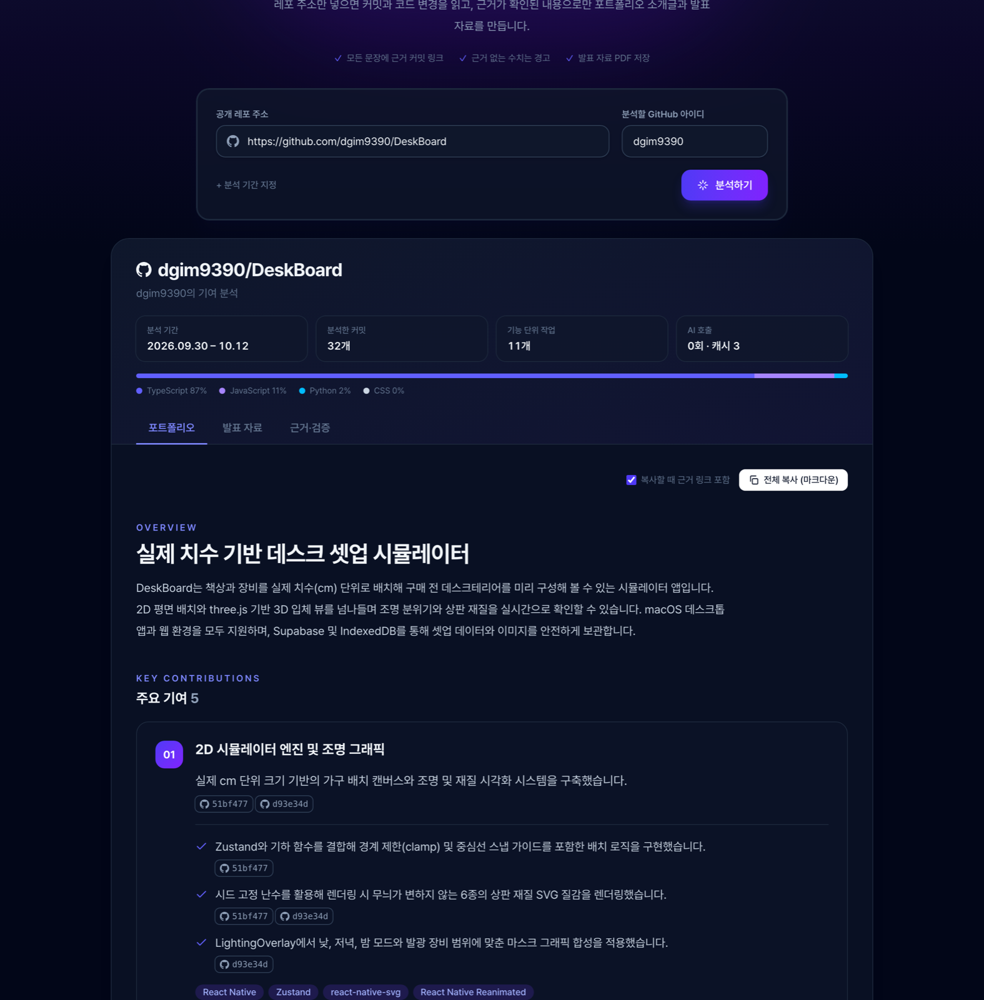
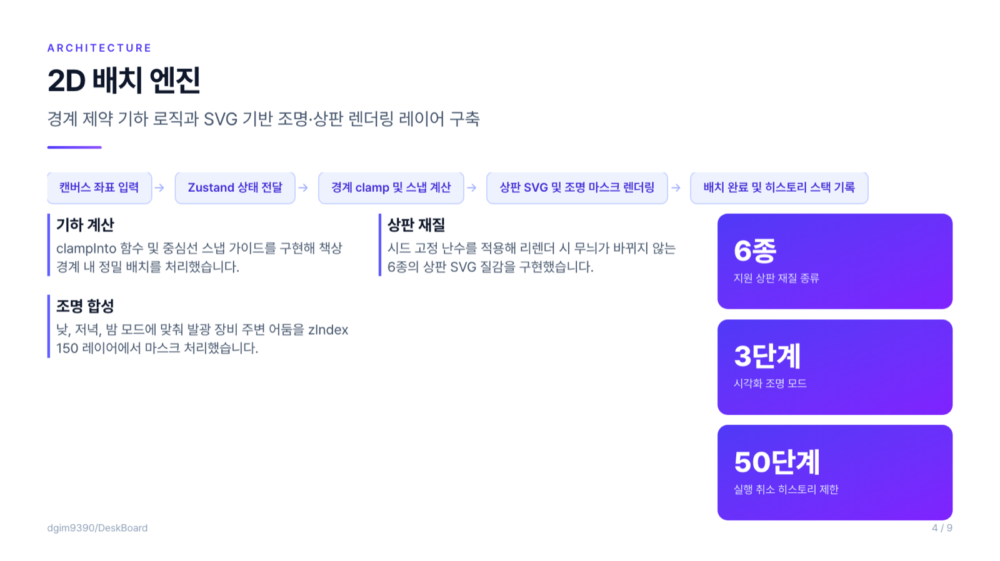

# CommitFolio

GitHub 공개 레포 주소를 넣으면 커밋·PR·diff를 읽고 **포트폴리오 소개글**과 **발표 자료**를 만들어 주는 웹앱입니다.

AI가 쓴 문장은 그럴듯하지만 근거가 없을 때가 많습니다. CommitFolio는 이 문제를 줄이는 데 집중합니다.

- **모든 문장에 근거 커밋 링크**가 붙습니다. 누르면 GitHub 커밋 페이지로 갑니다.
- **수치는 원문에 있을 때만** 씁니다. "성능 50% 개선" 같은 표현은 근거 커밋의 메시지나 diff에 그 숫자가 있어야 하고, 없으면 그 문장을 결과에서 뺍니다.
- **커밋 메시지보다 diff를 믿습니다.** "fix", "update"처럼 부실한 메시지도 실제 코드 변경으로 내용을 파악합니다.

<p align="center">
  
</p>

<p align="center">
  
  
</p>

<p align="center"><sub>dgim9390/DeskBoard(커밋 39개)를 분석한 결과입니다. 수치 카드(6종·3단계·50단계)는 근거 커밋에서 확인된 값만 표시됩니다.</sub></p>

## 주요 기능

- **포트폴리오 소개글:** 한 줄 소개와 개요, 주요 기여 4~6개, 분야별 기술 스택으로 구성됩니다.
  - 기여마다 제목, 한 줄 요약, 구체적인 구현 포인트 2~3개, 기술 태그가 붙습니다.
  - 문장별 복사와 마크다운 전체 복사를 지원합니다.
- **발표 자료:** 8~10장의 기술 발표 슬라이드입니다.
  - 표지 → 목차 → 문제 정의 → 핵심 기능·구조 → 기술 스택 → 정리 순서이고, 장 종류마다 레이아웃이 다릅니다.
  - 장마다 핵심 메시지 한 문장이 들어가고, 구조 장에는 흐름도가 있습니다.
  - 근거가 확인된 수치만 큰 숫자 카드로 보여줍니다.
  - 발표자 메모, 키보드 넘기기, 발표 모드(전체 화면), PDF 저장을 지원합니다.
- **결과 링크:** 주소창의 `?job=…&tab=slides&slide=4`로 같은 결과와 같은 장을 다시 열 수 있습니다. 서버가 켜져 있는 동안만 유효합니다.
- **협업 레포 지원:** 지정한 GitHub 아이디의 커밋만 골라서 분석합니다.
- **기간 지정:** 시작일·종료일을 지정할 수 있고, 기본값은 전체 기간입니다.
- **근거·검증 메모:** 커밋을 어떻게 묶었는지, 무엇을 분석에서 뺐는지, 검증에서 무엇을 걸러냈는지 보여줍니다.
- **캐시:** GitHub 응답과 AI 응답을 로컬에 저장합니다. 같은 레포를 다시 분석하면 AI 호출이 0회입니다.

## 빠른 시작

### 필요한 것

- Python 3.11 이상과 [uv](https://docs.astral.sh/uv/) (`brew install uv`)
- Node.js 20.19 이상 또는 22.12 이상
- git
- [Gemini API 키](https://aistudio.google.com) (무료 등급)

### 1. 설치

```bash
git clone https://github.com/dgim9390/commitfolio.git
cd commitfolio
cp .env.example .env          # 아래 '환경변수'를 보고 키를 채운다
cd backend && uv sync && cd ..
cd frontend && npm install && cd ..
```

### 2. 실행

터미널 두 개를 엽니다.

```bash
# 터미널 1: 백엔드 (http://localhost:8000)
cd backend && uv run uvicorn app.main:app --port 8000
```

```bash
# 터미널 2: 프론트엔드 (http://localhost:5173)
cd frontend && npm run dev
```

브라우저에서 http://localhost:5173 을 엽니다. 개발 서버가 `/api` 요청을 8000번 포트로 넘겨주므로 별도 CORS 설정은 필요 없습니다.

### 터미널에서만 쓰기 (CLI)

웹 화면 없이 단계별 결과를 확인할 수 있습니다. 결과는 `.cache/results/`에 JSON과 마크다운으로 저장됩니다.

```bash
cd backend
uv run commitfolio collect dgim9390/DeskBoard -u dgim9390            # 1. 수집·필터링 결과
uv run commitfolio group dgim9390/DeskBoard -u dgim9390 --explain    # 2. 커밋이 어떻게 묶였는지와 그 이유
uv run commitfolio generate dgim9390/DeskBoard -u dgim9390           # 3. 포트폴리오·발표 자료 생성
```

## 환경변수

`.env` 파일에 넣습니다. `.env`는 `.gitignore`에 들어 있어 커밋되지 않습니다.

| 이름 | 필수 | 설명 |
|---|---|---|
| `GEMINI_API_KEY` | ✔ (Gemini 사용 시) | [AI Studio](https://aistudio.google.com) → Get API key에서 무료로 발급 |
| `LLM_PROVIDER` | | `gemini`(기본값, 무료 등급) 또는 `claude`(유료) |
| `LLM_MODEL` | | 비우면 `gemini-3.8-flash` / `claude-opus-5-5` |
| `ANTHROPIC_API_KEY` | `claude`일 때 | [Anthropic Console](https://console.anthropic.com)에서 발급 (사용량만큼 과금) |
| `GITHUB_TOKEN` | | 없으면 GitHub API를 시간당 60회, 있으면 5000회까지 호출. 권한 없는 Fine-grained 토큰이면 충분 |

`config.py`의 다른 값도 같은 이름의 환경변수로 바꿀 수 있습니다. 예를 들어 diff 길이 상한은 `MAX_PATCH_CHARS_PER_FILE`입니다.

## 동작 방식

```
레포 URL + GitHub 아이디 + 기간
  │
  ▼
① 수집      REST API: 레포 정보·README·언어·이 사람의 커밋 목록·머지된 PR
            git clone: 커밋별 diff  (커밋 수와 상관없이 API 호출이 늘지 않음)
  ▼
② 필터링    lock 파일·빌드 산출물·바이너리·자동 생성 파일 제외, diff 길이 제한
  ▼
③ 그룹화    커밋을 '기능 단위 작업'으로 묶기
  ▼
④ 요약      AI가 작업마다 "무슨 문제를 어떻게 해결했는지" 정리 (여러 작업을 한 번에 요청)
  ▼
⑤ 생성      AI가 요약을 모아 포트폴리오 소개글 + 발표 자료 작성
  ▼
⑥ 검증      코드로 근거 확인 → 화면
```

DeskBoard(커밋 39개) 기준으로 GitHub API 5회, AI 호출 3회가 듭니다.

### 주요 설계 결정

- **diff는 REST API 대신 git clone으로 읽습니다.** 커밋 하나의 diff를 받는 데 API 1회가 들어서, 커밋이 많으면 호출 한도에 금방 걸리기 때문입니다. "누구의 커밋인지"는 GitHub가 아이디와 이메일을 매칭해 주는 REST로 가져오고, "무엇을 바꿨는지"는 로컬 git에서 읽습니다.
- **API 응답은 SQLite에 캐시합니다.** ETag로 조건부 요청을 보내므로, 내용이 그대로면 GitHub가 본문 없이 304를 돌려주고 캐시를 재사용합니다. 토큰이 있으면 304는 한도에서 차감되지 않습니다.
- **diff 길이 제한은 파일끼리 공평하게 나눕니다(water-filling).** 순서대로 자르면 앞 파일이 상한을 다 써서 뒤 파일 diff가 통째로 빠집니다. 그래서 작은 파일부터 "남은 상한 ÷ 남은 파일 수"만큼 나눠 줍니다. 그룹 단위 상한도 같은 방식으로 커밋끼리 나눕니다.
- **AI에게 커밋을 `C01` 같은 짧은 ID로 보여줍니다.** 40자리 SHA는 옮겨 적다 틀리기 쉽고, 짧은 ID는 틀리면 "없는 ID"로 바로 걸러낼 수 있습니다.
- **응답은 구조화된 출력(JSON 스키마)으로 받습니다.** 정해진 형식으로만 응답이 오므로 파싱 실패가 없습니다.
- **AI 제공자를 바꿀 수 있습니다.** AI 호출이 [`llm.py`](backend/app/pipeline/llm.py)의 `parse()` 한 곳에 모여 있어서, 제공자를 바꿔도 나머지 코드는 그대로입니다.

### 그룹화 기준

[`grouping/`](backend/app/pipeline/grouping)에 있으며 `Grouper` 인터페이스를 따르므로 알고리즘을 통째로 바꿀 수 있습니다.

0. **분석에서 빼는 커밋:** 문서만 바꾼 커밋, 버전 번호만 올린 커밋, 분석할 파일이 없는 커밋
1. **무조건 같은 그룹**
   - 같은 PR에 속한 커밋
   - **메시지 앞 이름표가 같은 커밋.** `3D: ...`, `[auth] ...`, `feat(api): ...` 형식을 인식합니다. 원하는 커밋끼리 묶고 싶으면 같은 이름표를 붙이면 됩니다.
2. **내용이 비슷하면 같은 그룹:** 바꾼 경로(60%) + 메시지(30%) + 시간(10%) 점수로 판단하고, 시간 제한은 없습니다.
   - 경로·단어는 **IDF 가중치**를 줍니다. 모든 커밋이 건드리는 `components/` 같은 흔한 폴더는 점수에 거의 반영되지 않습니다.
   - 한국어 메시지는 **두 글자 조각(bigram)**으로 비교합니다. 형태소 분석기 없이도 "화면을"과 "화면으로"가 겹칩니다.
   - 합칠 때는 **평균 연결(average-linkage) 군집화**를 씁니다. 이웃한 한 쌍만 비슷해도 전부 이어지는 단일 연결의 '사슬 현상'을 막기 위해서입니다. 힙과 지연 삭제(lazy deletion)로 O(E log E)입니다.
3. **그룹이 15개 커밋을 넘으면** 시간 간격이 가장 큰 곳에서 자릅니다.

### 근거 검증

[`validate.py`](backend/app/pipeline/validate.py)와 [`summarize.py`](backend/app/pipeline/summarize.py)에 있습니다.

- AI가 쓴 수치(`facts`)는 **커밋에서 글자 그대로 복사한 인용**이 있어야 남깁니다. 인용이 실제 커밋에 없으면 버립니다.
- 없는 커밋 ID는 근거에서 빼고, 근거가 하나도 남지 않은 문장은 삭제합니다.
- 문장 속 숫자가 근거 커밋이나 README에 없으면 그 문장을 뺍니다. 슬라이드의 숫자 카드도 마찬가지입니다.
  - `3D`, `v1.3`, `SHA-256`, `3차원`처럼 이름의 일부인 숫자는 수치로 보지 않습니다.
  - 코드에 `a === 192 && b === 168`처럼 나뉘어 있는 IP 주소(`192.168`)도 확인된 것으로 봅니다.
- 무엇을 왜 뺐는지는 화면의 "근거·검증" 탭에 남습니다.

## 폴더 구조

```
commitfolio/
├── .env.example
├── backend/                     Python · FastAPI · uv
│   ├── app/
│   │   ├── main.py              FastAPI 앱
│   │   ├── api/jobs.py          분석 작업(백그라운드 스레드) 관리
│   │   ├── cli.py               터미널 명령 (collect / group / generate)
│   │   ├── config.py            환경변수 설정
│   │   ├── errors.py            사용자에게 보여줄 한국어 에러
│   │   ├── models.py            모든 단계가 주고받는 데이터 타입
│   │   ├── github/              ① 수집: REST 클라이언트, SQLite 캐시, git clone
│   │   └── pipeline/
│   │       ├── filters.py       ② 필터링·diff 자르기
│   │       ├── grouping/        ③ 그룹화 (base: 인터페이스, rules: 규칙, heuristic: 유사도)
│   │       ├── llm.py           AI 호출 (Gemini / Claude), 응답 캐시
│   │       ├── prompts/         AI 프롬프트 (system.md에 '지어내기 금지' 원칙)
│   │       ├── summarize.py     ④ 요약
│   │       ├── generate.py      ⑤ 생성
│   │       ├── validate.py      ⑥ 검증
│   │       └── runner.py        ①~⑥을 잇는 함수 (CLI와 API가 공유)
│   └── tests/                   pytest (AI는 가짜 객체로 대체해 비용 0)
├── frontend/                    React · Vite · TypeScript · Tailwind
│   └── src/
│       ├── App.tsx              입력 → 진행 상태(폴링) → 결과
│       ├── api.ts, types.ts     백엔드 호출과 타입
│       └── components/          폼, 진행 상태, 포트폴리오·발표 자료·근거 탭
│           └── SlideCard.tsx    슬라이드 한 장 (장 종류별 레이아웃, 화면·썸네일·PDF 공용)
├── docs/                        README 스크린샷
└── .cache/                      (git 제외) GitHub·AI 캐시, 클론한 레포, CLI 결과
```

## 테스트

```bash
cd backend && uv run pytest        # 필터, diff 파싱, 그룹화, 요약 묶기, 근거 검증
cd frontend && npm run build       # 타입 검사 + 빌드
```

## 알아둘 점

- **Gemini 무료 등급**
  - 하루·분당 호출 수 제한이 있습니다. 정확한 값은 [AI Studio](https://aistudio.google.com/rate-limit)에서 확인할 수 있습니다.
  - 하루 한도를 다 쓰면 화면에 초기화 시각(미국 태평양 시간 자정)을 안내합니다.
  - 이미 받은 응답은 캐시에 남아 있어서, 다시 실행하면 남은 부분만 호출합니다.
  - **무료 등급 입력은 Google 제품 개선에 쓰일 수 있습니다.** 공개 레포만 분석하세요.
- **근거 커밋이 문장 내용과 정확히 맞는지는 검증하지 않습니다.** 커밋 ID가 실제로 있는지와 숫자가 근거에 나오는지만 확인하므로, 숫자가 없는 문장에는 가끔 같은 작업의 다른 커밋이 근거로 붙을 수 있습니다.
- **본인 커밋이 덜 잡히는 경우:** 커밋 작성자 이메일이 GitHub 계정에 등록되어 있지 않으면 그 커밋은 빠집니다. CLI의 `collect` 결과에 "레포 전체 N개 중 M개"가 표시되니 비교해 보세요.
- **진행 중인 작업 목록은 서버 메모리에만 있습니다.** 서버를 재시작하면 목록은 사라지지만 캐시는 남습니다.

## 다음 단계

- GitHub OAuth 로그인과 비공개 레포 분석
- 배포
- 문장과 근거 커밋의 내용 일치도 검사
