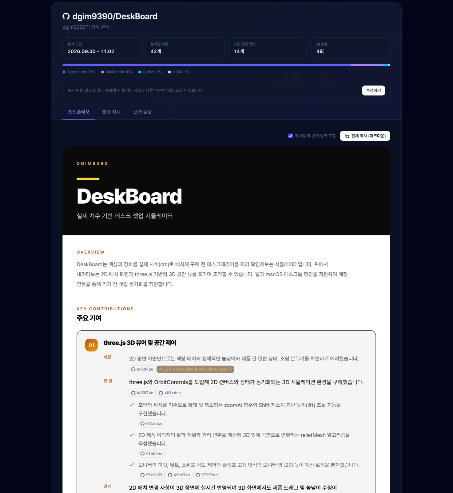
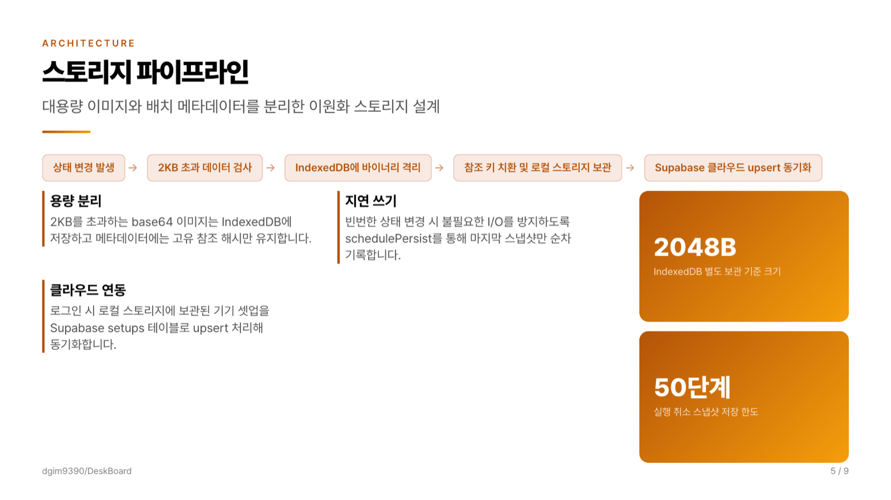
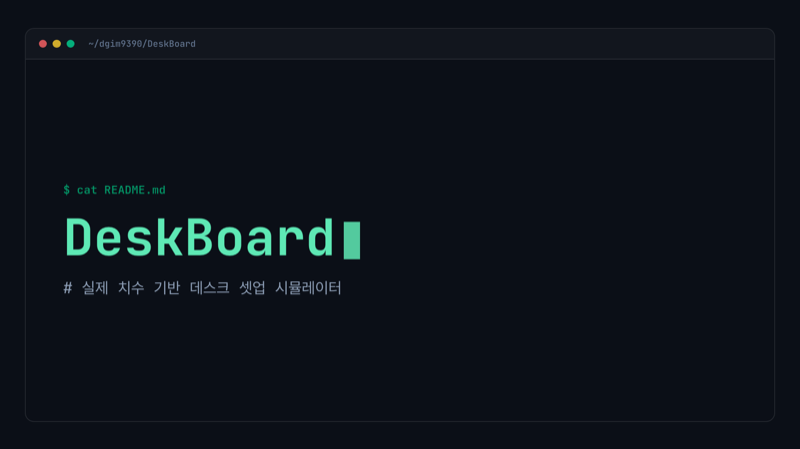
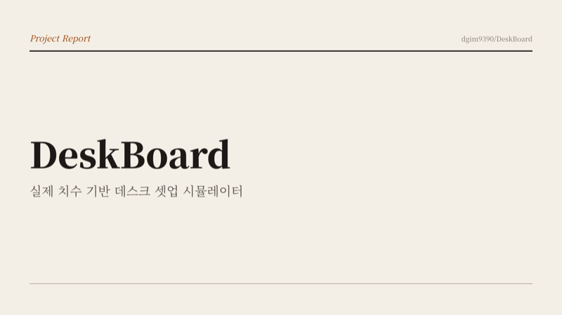

# CommitFolio

**GitHub 레포 주소만 넣으면, 커밋과 코드 변경을 읽고 포트폴리오 소개글과 발표 자료를 만들어 주는 웹앱입니다.**

🔗 **https://commitfolio.vercel.app** · 초대받은 사람만 쓸 수 있도록 접근 코드가 걸려 있습니다.

<p align="center">
  
</p>
<p align="center">
  
  
</p>
<p align="center"><sub>dgim9390/DeskBoard(커밋 39개)를 분석한 결과</sub></p>

## 왜 만들었나

AI에게 "내 프로젝트로 포트폴리오 써 줘"라고 하면 그럴듯하지만 근거 없는 문장이 나옵니다. CommitFolio는 **실제 커밋으로 확인되는 내용만** 쓰도록 만드는 데 집중했습니다.

- **모든 문장에 근거 커밋 링크**가 붙습니다. 누르면 GitHub의 그 커밋으로 갑니다.
- **수치는 원문에 있을 때만** 씁니다. "성능 50% 개선" 같은 숫자가 근거 커밋에 없으면 그 문장은 결과에서 빠집니다.
- **커밋 메시지보다 코드 변경(diff)을 봅니다.** "fix", "update" 같은 부실한 메시지여도 실제로 바뀐 내용으로 판단합니다.

## 무엇을 만들어 주나

**포트폴리오 소개글**
- 한 줄 소개, 프로젝트 개요, 분야별 기술 스택
- 주요 기여 4~6개. 기여마다 **배경 → 한 일 → 결과** 순서로 정리하고, 구현 포인트와 기술 태그를 붙입니다.

**발표 자료 (8~10장)**
- 표지 → 목차 → 문제 정의 → 핵심 기능·구조 → 기술 스택 → 정리
- 장마다 핵심 메시지 한 문장, 구조 장에는 흐름도, 근거가 확인된 수치만 큰 숫자 카드로
- 발표자 메모, 발표 모드(전체 화면), PDF 저장

**레포마다 다른 디자인**
- AI가 프로젝트 성격을 보고 **색(15) × 배경(5) × 글꼴(4) × 표지(4)** 를 조합합니다. 포트폴리오와 발표 자료에 같이 적용됩니다.

| 터미널 · 개발 도구 | 페이퍼 · 문서·연구 | 오션 · 데이터·모바일 | 모노 · 미니멀 |
|---|---|---|---|
|  |  |  |  |

**직접 수정**
- 마음에 안 들거나 사실과 다른 부분은 "수정하기"로 고칠 수 있습니다. 문장, 항목, 슬라이드 순서, 디자인 모두 바꿀 수 있습니다.
- 사람이 고친 문장에는 "직접 수정" 표시가 붙어 AI가 근거로 확인한 문장과 구분됩니다. AI 원본으로 언제든 되돌릴 수 있습니다.

## 사용 방법

1. https://commitfolio.vercel.app 에 들어가 접근 코드를 입력합니다.
2. 공개 레포 주소와 분석할 GitHub 아이디를 넣습니다. 협업 레포라면 본인 아이디만 넣으면 그 사람의 커밋만 분석합니다. 기간도 지정할 수 있습니다.
3. 1분 안팎이면 결과가 나옵니다. **포트폴리오 / 발표 자료 / 근거·검증** 탭에서 확인하고, 복사하거나 PDF로 저장합니다.

> 무료 서버라 한동안 아무도 쓰지 않으면 잠듭니다. 처음 접속할 때 "서버를 깨우는 중"이 보이면 1분 정도 기다려 주세요.

## 어떻게 동작하나

```
레포 URL + GitHub 아이디
  ① 수집     GitHub API로 이 사람의 커밋 목록·PR·README, git clone으로 커밋별 diff
  ② 필터링   lock 파일·빌드 산출물·이미지 제외, diff 길이 제한
  ③ 그룹화   커밋을 '기능 단위 작업'으로 묶기
  ④ 요약     AI가 작업마다 "무슨 문제를 어떻게 해결했는지" 정리
  ⑤ 생성     AI가 포트폴리오·발표 자료·디자인 조합 작성
  ⑥ 검증     근거 커밋·숫자·내용 일치를 코드로 확인
```

**설계에서 신경 쓴 점**
- **API 호출 최소화:** "누구의 커밋인지"는 GitHub API로, "무엇을 바꿨는지"는 git clone으로 읽습니다. 그래서 커밋이 많아도 API 호출이 늘지 않습니다(DeskBoard 기준 GitHub 5회, AI 3회).
- **그룹화:** 같은 PR이나 같은 메시지 이름표(`3D:`, `feat(api):`)는 무조건 묶습니다. 나머지는 바꾼 경로와 메시지의 유사도(IDF 가중치)로 **평균 연결 군집화**를 해서, 이웃끼리만 비슷해도 전부 이어지는 "사슬 현상"을 막습니다.
- **diff 길이 제한:** 파일끼리 공평하게 나눠(water-filling) 앞 파일이 상한을 다 쓰고 뒤 파일이 통째로 빠지는 일이 없게 합니다.
- **AI 출력 검증:**
  - AI에게는 커밋을 `C01` 같은 짧은 ID로 보여주고, 없는 ID는 걸러냅니다.
  - 수치는 커밋에서 글자 그대로 복사한 인용이 있어야 쓸 수 있습니다.
  - 문장과 근거 커밋의 단어 겹침(BM25 방식)을 계산해서, 같은 작업의 엉뚱한 커밋이 근거로 붙으면 더 맞는 커밋으로 바꿉니다.
- **캐시:** GitHub 응답과 AI 응답을 저장해서 같은 레포를 다시 분석하면 AI 호출이 0회입니다.

## 기술 스택

| 영역 | 사용 기술 |
|---|---|
| 프론트엔드 | React, TypeScript, Vite, Tailwind CSS |
| 백엔드 | Python, FastAPI, Pydantic, httpx, SQLite(캐시) |
| AI | Gemini API (무료 등급, 기본) · Claude API (선택) |
| 배포 | Vercel(화면) + Render(API, Docker) |

## 배포 구조

```
브라우저 ──▶ Vercel (화면, commitfolio.vercel.app)
               │  /api/* 요청을 그대로 전달
               ▼
             Render (FastAPI, Docker) ──▶ GitHub API, Gemini API
```

- 화면은 Vercel, API는 Render 무료 플랜에서 돌아갑니다. 연결 설정은 [`frontend/vercel.json`](frontend/vercel.json)에 있습니다.
- Render는 [`Dockerfile`](Dockerfile)로 빌드합니다. 이 이미지는 화면까지 함께 내보내서 Render 주소만으로도 동작합니다.
- 비밀값은 이미지에 넣지 않고 Render 환경변수에만 둡니다.

**Render 환경변수**

| 이름 | 설명 |
|---|---|
| `GEMINI_API_KEY` | [AI Studio](https://aistudio.google.com/apikey)에서 발급 (무료) |
| `GITHUB_TOKEN` | **공개 레포 읽기 전용** Fine-grained 토큰. 없으면 GitHub API가 시간당 60회로 제한됩니다 |
| `ACCESS_CODE` | 이 코드를 아는 사람만 사용 가능 |
| `DAILY_ANALYSIS_LIMIT` · `PER_IP_DAILY_LIMIT` | 하루 분석 횟수 상한 (전체 · IP당). Gemini 무료 한도를 지키기 위해 |
| `PROXY_HOPS` | `2` (Vercel → Render로 프록시가 두 겹이라 방문자 IP를 올바로 세기 위해) |

선택 항목: `LLM_PROVIDER`(gemini/claude), `LLM_MODEL`, `LLM_FALLBACK_MODEL`(혼잡할 때 대신 쓸 모델), `MAX_REPO_SIZE_MB`(기본 500), `MAX_COMMITS`(기본 400), `CACHE_DIR`.

## 로컬에서 실행하기

필요한 것: Python 3.11+와 [uv](https://docs.astral.sh/uv/), Node.js 20.19+, git, Gemini API 키

```bash
git clone https://github.com/dgim9390/commitfolio.git && cd commitfolio
cp .env.example .env            # GEMINI_API_KEY 등을 채운다
cd backend && uv sync && cd ../frontend && npm install && cd ..
```

```bash
# 터미널 1: API (http://localhost:8000)
cd backend && uv run uvicorn app.main:app --reload --port 8000
```

```bash
# 터미널 2: 화면 (http://localhost:5173)
cd frontend && npm run dev
```

화면 없이 터미널에서 단계별로 볼 수도 있습니다. 결과는 `.cache/results/`에 저장됩니다.

```bash
cd backend
uv run commitfolio collect dgim9390/DeskBoard -u dgim9390           # 수집·필터링
uv run commitfolio group dgim9390/DeskBoard -u dgim9390 --explain   # 그룹화와 그 이유
uv run commitfolio generate dgim9390/DeskBoard -u dgim9390          # 전체 생성
```

테스트는 `cd backend && uv run pytest`로 돌립니다. AI는 가짜 객체로 대신해서 비용이 들지 않습니다.

## 폴더 구조

```
commitfolio/
├── backend/app/
│   ├── main.py            API (분석 시작, 진행 상황, 직접 수정 저장, 접근 코드·사용 제한)
│   ├── github/            ① 수집 (GitHub API 클라이언트, SQLite 캐시, git clone)
│   └── pipeline/
│       ├── filters.py     ② 필터링
│       ├── grouping/      ③ 그룹화
│       ├── summarize.py   ④ 요약
│       ├── generate.py    ⑤ 생성 (prompts/ 에 AI 지시문)
│       ├── validate.py    ⑥ 검증 (근거 ID, 숫자)
│       ├── relevance.py   ⑥ 근거 내용 일치도
│       └── llm.py         Gemini/Claude 호출, 다시 시도, 응답 캐시
├── frontend/src/
│   ├── components/        입력 폼, 진행 상태, 포트폴리오·발표 자료·근거 탭, 편집기
│   └── design.ts          디자인 조합 (색·배경·글꼴·표지)
├── Dockerfile             배포 이미지 (화면 + API)
└── docs/                  README 이미지
```

## 한계

- **공개 레포만** 분석합니다.
- **Gemini 무료 등급**은 하루 호출 수가 적고, 입력 내용이 Google 제품 개선에 쓰일 수 있습니다. 하루 한도를 다 쓰면 한국 시간 오후 4~5시쯤 초기화됩니다.
- **무료 서버는 디스크가 유지되지 않아**, 서버가 재시작되면 저장된 결과 링크와 직접 수정본이 사라집니다. 같은 레포를 다시 분석하면 됩니다.
- 커밋 작성자 이메일이 GitHub 계정에 등록돼 있지 않으면 그 커밋은 본인 것으로 잡히지 않습니다.
- 근거 일치도 검사는 단어가 겹치는 정도로 판단해서, 뜻은 같아도 단어가 전혀 다르면 놓칠 수 있습니다.

## 앞으로

- GitHub 로그인과 비공개 레포 분석
- 결과를 오래 보관하기 위한 DB 도입
